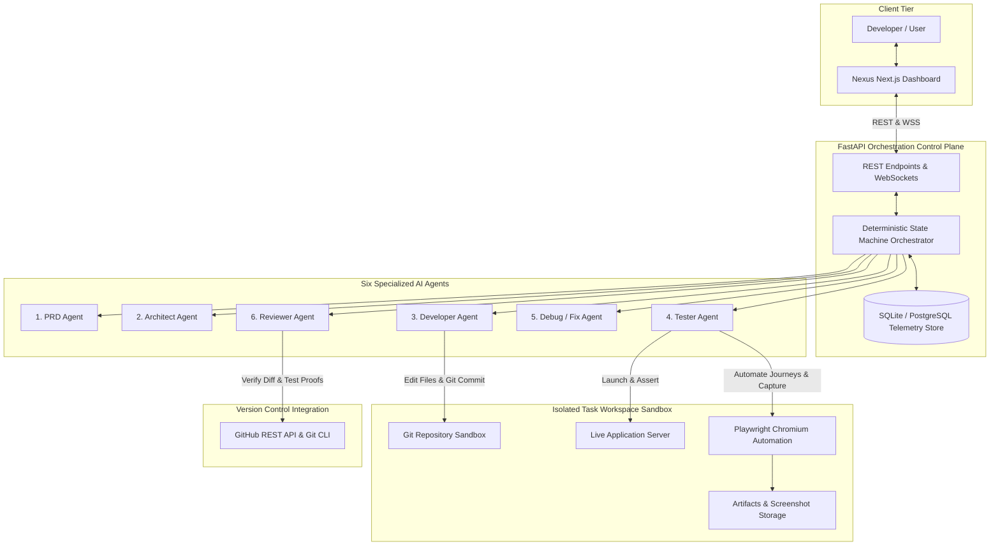
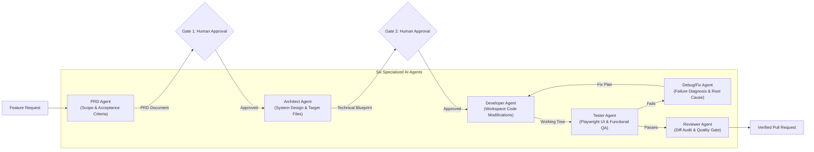
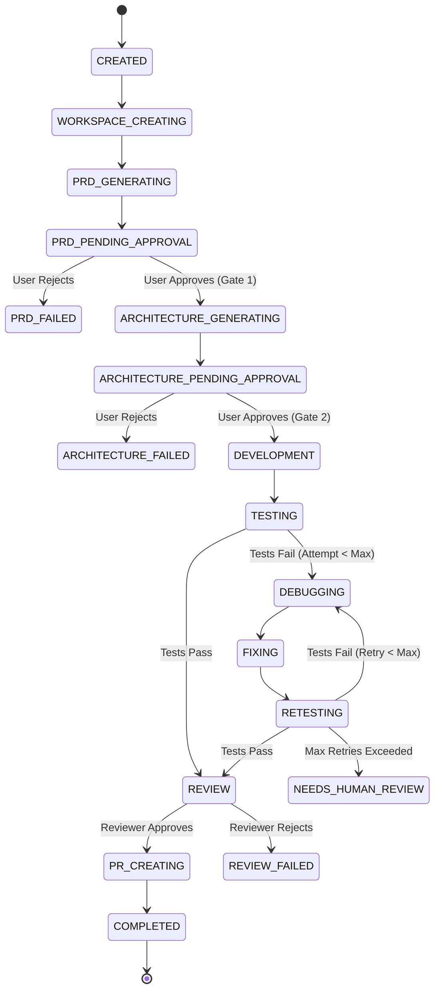
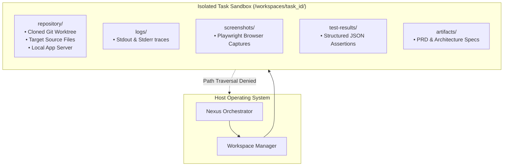
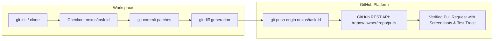
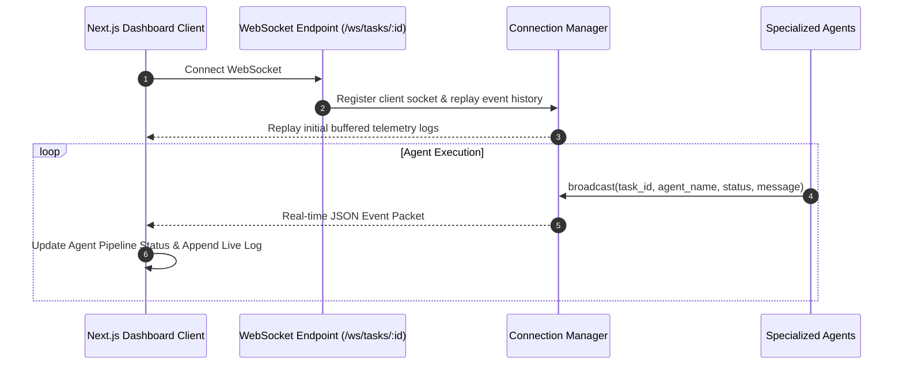
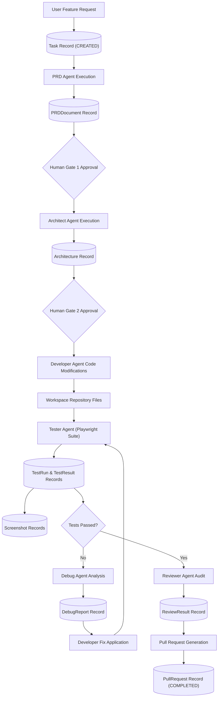

# Nexus — Autonomous AI Software Engineering Platform

> **Nexus** is an autonomous software engineering platform that transforms natural language feature requests into fully implemented, tested, and verified pull requests. Operating within isolated disposable workspaces, Nexus coordinates an ensemble of six specialized agents alongside deterministic orchestration, dual human-in-the-loop approval gates, automated Playwright browser testing, and a self-correction loop.

---

## 1. High-Level System Architecture



---

## 2. Six-Agent Architecture



---

## 3. Orchestrator Workflow (State Machine)



---

## 4. Autonomous Self-Correction Loop

```mermaid
sequenceDiagram
    autonumber
    participant Dev as Developer Agent
    participant Box as Isolated Workspace
    participant Test as Tester Agent
    participant Play as Playwright Browser
    participant Dbg as Debug Agent
    participant Rev as Reviewer Agent

    Dev->>Box: Write code changes to target files
    Dev->>Box: Commit changes to task branch
    Test->>Box: Start application test server
    Test->>Play: Launch Chromium (1280x800)
    Test->>Play: Execute Scenario 1 (Desktop UI & Catalog)
    Play-->>Test: Capture desktop screenshot
    Test->>Play: Execute Scenario 2 (Interaction & Counter)
    Play-->>Test: Capture interaction screenshot
    Test->>Play: Execute Scenario 3 (Mobile 375px Viewport)
    Play-->>Test: Assertion fails (Element hidden)
    Play-->>Test: Capture mobile failure screenshot

    Test-->>Dbg: Diagnostic Packet (Failure logs + Screenshots)
    Dbg->>Box: Inspect target file classes & styles
    Dbg-->>Dbg: Diagnose root cause ('hidden md:' class constraint)
    Dbg-->>Dev: Surgical Fix Plan (Update class to visible)

    Dev->>Box: Apply fix to target file
    Dev->>Box: Commit fix: 'fix(ui): ensure mobile visibility'

    Test->>Play: Retest Mobile 375px Viewport
    Play-->>Test: Assertion passes!
    Play-->>Test: Capture verified mobile screenshot
    Test-->>Rev: Verification Evidence (All scenarios passed)
    Rev->>Rev: Audit Git diff against PRD acceptance criteria
    Rev-->>Dev: Review Approved
```

---

## 5. Isolated Workspace Architecture



---

## 6. GitHub Integration Lifecycle



---

## 7. Live Progress Telemetry via WebSockets



---

## 8. End-to-End Data Flow



---

## 9. Technology Stack

- **Frontend**: Next.js 14, React 18, TypeScript, Tailwind CSS, Lucide Icons, WebSocket client.
- **Backend**: Python 3.10+, FastAPI, Pydantic, SQLAlchemy, Uvicorn, WebSockets.
- **AI Engine**: OpenAI API (`gpt-4o`), Structured JSON Schema outputs, deterministic synthesizer fallback.
- **Testing & Vision**: Playwright Headless Chromium, automated assertions, high-res screenshots.
- **VCS & Workspace**: Git CLI, GitHub REST API, isolated directory and container sandboxing.
- **Database**: SQLite (MVP) / PostgreSQL (production-ready).
